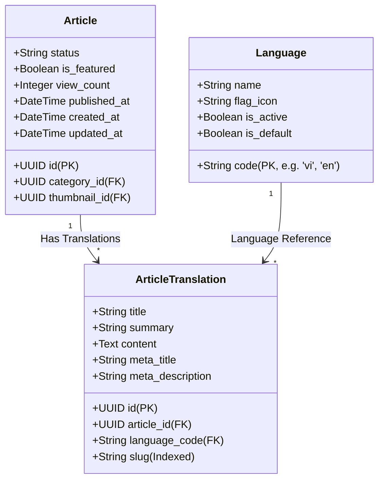
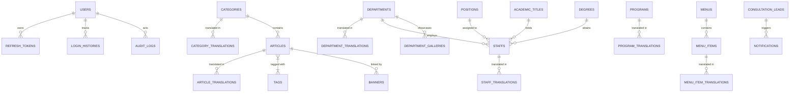

# 🗄️ Thiết Kế Cơ Sở Dữ Liệu (Database Design & Modeling)

Hệ thống **KTCN Backend REST API** sử dụng **PostgreSQL 17** (tích hợp extension `pgvector`) làm hệ quản trị cơ sở dữ liệu quan hệ chính. Kiến trúc CSDL được chuẩn hóa nghiêm ngặt, tối ưu cho xử lý bất đồng bộ, tính toàn vẹn dữ liệu và hỗ trợ đa ngôn ngữ mở rộng (Internationalization - i18n).

---

## 1. 🌐 Triết Lý Thiết Kế Đa Ngôn Ngữ (i18n Pattern: Entity - Translation)

Để phục vụ môi trường đại học chuẩn quốc tế, tất cả các thực thể nội dung trên hệ thống đều áp dụng mô hình phân tách **Bảng Thực Thể Cốt Lõi (Core Entity)** và **Bảng Bản Dịch Đa Ngữ (Entity Translation)**.

### Sơ đồ cấu trúc mẫu:


### Ưu điểm vượt trội của mô hình này:
1. **Mở rộng ngôn ngữ không giới hạn:** Khi cần bổ sung ngôn ngữ mới (ví dụ: tiếng Nhật `ja`, tiếng Pháp `fr`), chỉ cần thêm một dòng trong bảng `languages` và thêm bản dịch trong bảng dịch mà không cần thay đổi bất kỳ cột nào của bảng chính.
2. **SEO Friendly:** Mỗi ngôn ngữ sở hữu riêng `slug`, `meta_title`, `meta_description` độc lập, tối ưu hóa cho các công cụ tìm kiếm quốc tế.
3. **Hiệu năng truy vấn cao:** Tận dụng `selectinload` của SQLAlchemy 2.0 để gom nhóm câu truy vấn lấy bản dịch theo ngôn ngữ mong muốn trong một query duy nhất.

---

## 2. 📊 Sơ Đồ Thực Thể Quan Hệ Chính (Core Entity Relationship Diagram)



---

## 3. 📑 Danh Sách Các Bảng Cốt Lõi Trong Hệ Thống

| Tên Bảng | Vai trò nghiệp vụ | Cơ chế liên kết & Chỉ mục chính |
|---|---|---|
| `users` | Tài khoản quản trị, CTV nội dung | PK `id` (UUID), Unique `username`, `email`. Phân quyền qua role/permissions. |
| `refresh_tokens` | Quản lý phiên đăng nhập | FK `user_id`, Token hash, thời gian hết hạn `expires_at`, trạng thái thu hồi `is_revoked`. |
| `login_histories` | Ghi vết đăng nhập | FK `user_id`, địa chỉ IP, User-Agent, trạng thái đăng nhập, lý do thất bại. |
| `audit_logs` | Ghi vết thay đổi dữ liệu Admin | FK `actor_id`, `action` (CREATE, UPDATE, DELETE), `entity_name`, `entity_id`, `changes` (JSON diff). |
| `languages` | Danh mục ngôn ngữ hỗ trợ | PK `code` (e.g. `'vi'`, `'en'`), cờ kích hoạt `is_active`, cờ mặc định `is_default`. |
| `categories` & translations | Danh mục tin tức, bài viết | Hỗ trợ quan hệ phân cấp cha-con (`parent_id`), cờ khóa `is_locked`, thứ tự `sort_order`. |
| `articles` & translations | Bài viết, tin tức, thông báo | FK `category_id`, trạng thái `status` (`draft`, `published`, `archived`), lượt xem `view_count`, `published_at`. |
| `tags` & translations | Thẻ phân loại bài viết | Quan hệ nhiều-nhiều (N-N) với `articles` qua bảng trung gian `article_tags`. |
| `departments` & translations | Khoa, Viện, Bộ môn trực thuộc | Mã đơn vị `code`, slug đa ngữ, thông tin liên hệ, trưởng đơn vị. |
| `staffs` & translations | Cán bộ, Giảng viên | FK `department_id`, FK `position_id`, FK `academic_title_id`, FK `degree_id`, email, điện thoại, lý lịch khoa học. |
| `programs` & translations | Ngành & Chương trình đào tạo | Hệ đào tạo (Đại học, Sau đại học), chuẩn đầu ra, thời gian đào tạo, profile học thuật. |
| `department_galleries` | Thư viện ảnh hoạt động | FK `department_id`, chứa danh sách ảnh `gallery_items` phục vụ hiển thị slider. |
| `consultation_leads` | Thông tin đăng ký tư vấn tuyển sinh | Họ tên, số điện thoại, email, ngành quan tâm, ghi chú, trạng thái xử lý (`pending`, `contacted`, `enrolled`). |
| `notifications` | Thông báo quản trị nội bộ | Tiêu đề, nội dung, loại thông báo, trạng thái đã đọc `is_read`. |
| `push_subscriptions` | Đăng ký nhận thông báo trình duyệt | Cấu hình Web Push chuẩn W3C: `endpoint`, `p256dh` key, `auth` key. |
| `media_items` | Quản lý tập tin lưu trên MinIO | Tên tệp gốc, object key lưu trữ, dung lượng bytes, MIME type, kích thước ảnh (width, height). |
| `system_statistics` | Bảng tổng hợp số liệu hiển thị | Lượt xem tổng, lượt xem hôm nay, số bài viết, số giảng viên. |
| `ai_request_logs` | Nhật ký tiêu thụ token AI | Model sử dụng, số lượng prompt tokens, completion tokens, ước tính chi phí, thời gian phản hồi. |

---

## 4. ⚡ Chiến Lược Đánh Chỉ Mục (Indexing Strategy)

Để tối ưu hóa tốc độ truy vấn đối với dữ liệu lớn:
1. **B-Tree Indexes trên các cột tìm kiếm và lọc:**
   - `slug` trên tất cả các bảng bản dịch (Unique trên cặp `language_code` + `slug`).
   - `status`, `published_at`, `category_id` trên bảng `articles` phục vụ tải tin tức trang chủ và phân trang.
   - `department_id`, `sort_order` trên bảng `staffs`.
2. **Index hỗ trợ tìm kiếm toàn văn (Full-Text Search):**
   - Đánh chỉ mục trên trường tiêu đề (`title`) và tóm tắt (`summary`).
3. **Cascade Delete chặt chẽ:**
   - Xóa một bản ghi chính (như `Article`, `Department`, `Category`) sẽ tự động xóa sạch (Cascade Delete) toàn bộ các bản ghi trong bảng dịch và bảng trung gian liên quan, ngăn ngừa dữ liệu rác mồ côi (Orphan Records).

---

## 5. 🔄 Quy Trình Quản Trị Migration Với Alembic

Mọi thay đổi cấu trúc bảng trong code SQLAlchemy đều được phản ánh vào CSDL thông qua Alembic:

```bash
# 1. Sau khi chỉnh sửa model Python, tạo migration script tự động:
alembic revision --autogenerate -m "mo_ta_thay_doi_ngan_gon"

# 2. Kiểm tra nội dung script sinh ra trong thư mục migrations/versions/

# 3. Đồng bộ vào CSDL PostgreSQL:
alembic upgrade head

# 4. Rollback lại 1 bước nếu có sự cố:
# alembic downgrade -1
```
