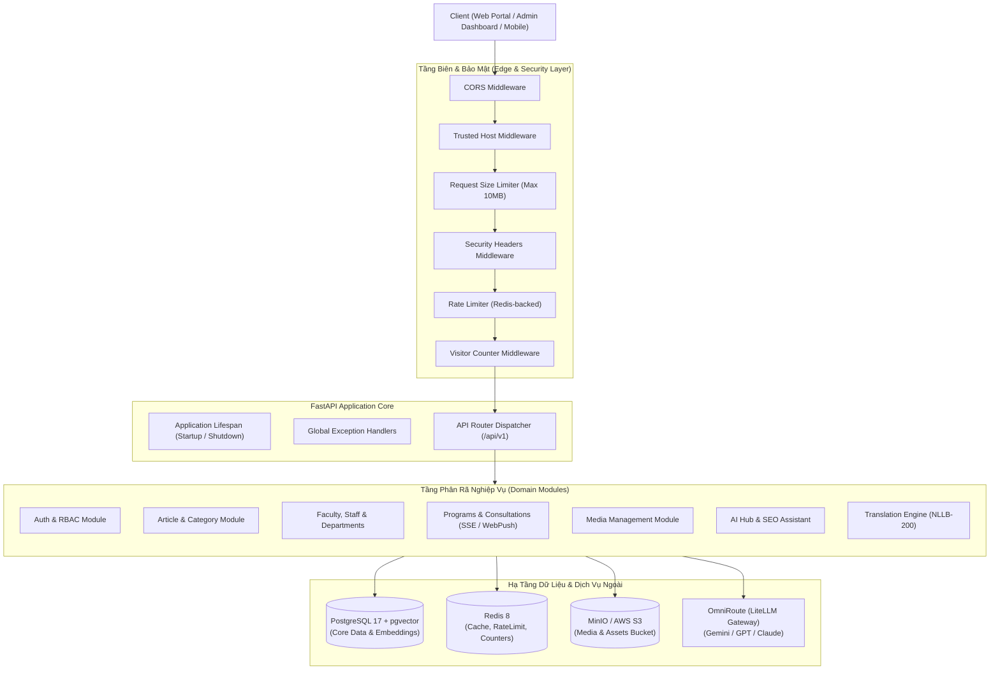

# 🏛️ Tổng Quan Kiến Trúc Hệ Thống (Architecture Overview)

Dự án **KTCN Backend REST API** được thiết kế theo mô hình **Modular Monolith** kết hợp với các nguyên lý của **Clean Architecture**, mang lại sự cân bằng tối ưu giữa tính dễ bảo trì, khả năng mở rộng (Scalability) và hiệu năng xử lý cao nhờ sức mạnh bất đồng bộ (AsyncIO) của FastAPI và SQLAlchemy 2.0.

---

## 1. 📐 Sơ Đồ Kiến Trúc Hệ Thống (System Architecture Diagram)



---

## 2. 📂 Cấu Trúc Mã Nguồn Phân Tầng (Directory Structure)

Toàn bộ logic của ứng dụng được tổ chức khoa học trong thư mục `app/`:

```text
app/
├── main.py                     # Điểm khởi tạo FastAPI, cấu hình Lifespan, Middleware, Mount Router
├── core/                       # Thành phần nền tảng của hệ thống
│   ├── config.py               # Settings (Pydantic BaseSettings) đọc biến môi trường .env
│   ├── database.py             # Khởi tạo SQLAlchemy Async Engine và AsyncSessionLocal
│   ├── security.py             # Tiện ích mã hóa mật khẩu bcrypt, tạo/giải mã JWT
│   ├── exceptions.py           # Định nghĩa Exception tùy chỉnh và Handler chặn lỗi toàn cục
│   ├── logger.py               # Cấu hình xoay vòng nhật ký (Rotating Log) bằng Loguru
│   └── middleware/             # Toàn bộ Middleware can thiệp vào Request/Response pipeline
│       ├── rate_limit.py       # Giới hạn tần suất gọi API qua Redis
│       ├── security.py         # Thêm HTTP Security Headers và kiểm soát kích thước body
│       └── visitor_counter.py  # Đếm lượt truy cập Cổng thông tin người dùng
├── common/                     # Các lớp cơ sở dùng chung cho Model và Data Layer
│   ├── models/                 # BaseModel, TimestampMixin, SEOFieldsMixin
│   └── repositories/           # BaseRepository cung cấp CRUD chuẩn
├── shared/                     # Dịch vụ & Tiện ích dùng chung giữa các Module
│   ├── redis.py                # Quản lý vòng đời kết nối Redis Client Pool
│   ├── rate_limiter.py         # Logic giới hạn tần suất dựa trên Token Bucket / Redis
│   ├── pagination.py           # Tiện ích phân trang danh sách (Page, PageSize, Meta)
│   ├── sort_order.py           # Tiện ích sắp xếp thứ tự hiển thị
│   ├── security/encryption.py  # Mã hóa đối xứng AES các dữ liệu nhạy cảm
│   ├── seo/helper.py           # Tiện ích sinh slug URL chuẩn SEO và thẻ Meta
│   └── ai/                     # Service tích hợp AI nền tảng
└── modules/                    # Các module nghiệp vụ độc lập (Domain Modules)
    ├── auth/                   # Xác thực, Quản lý User, Phân quyền RBAC
    ├── article/                # Quản lý Bài viết, Tin tức, Sự kiện
    ├── category/               # Danh mục bài viết (hỗ trợ phân cấp cha - con)
    ├── tag/                    # Thẻ bài viết đa ngôn ngữ
    ├── department/             # Khoa, Viện, Bộ môn trực thuộc
    ├── staff/                  # Danh sách Giảng viên, Cán bộ quản lý
    ├── position/               # Danh mục Chức vụ (Trưởng khoa, Trưởng bộ môn, ...)
    ├── academic_title/         # Học hàm (Giáo sư, Phó Giáo sư)
    ├── degree/                 # Học vị (Tiến sĩ, Thạc sĩ, Kỹ sư, Cử nhân)
    ├── program/                # Chương trình Đào tạo Đại học & Sau đại học
    ├── consultation/           # Đăng ký tư vấn tuyển sinh (kèm SSE thông báo realtime)
    ├── notification/           # Thông báo quản trị & Web Push Notifications
    ├── media/                  # Quản lý tập tin tải lên MinIO / S3
    ├── banner/                 # Banner quảng bá, Slider trang chủ
    ├── menu/                   # Menu điều hướng Header & Footer cổng thông tin
    ├── language/               # Danh sách ngôn ngữ hệ thống hỗ trợ
    ├── translation/            # Dịch thuật tự động AI & Quản lý bản dịch
    ├── ai_hub/                 # AI Gateway quản lý mô hình, log chi phí token
    ├── search/                 # Tìm kiếm tổng hợp
    ├── statistics/             # Thống kê lượt truy cập và số liệu hiển thị
    └── dashboard/              # Tổng hợp chỉ số cho Admin Dashboard
```

---

## 3. 🛡️ Chuỗi Middleware Bảo Mật (Middleware Pipeline)

Mỗi Request gửi đến hệ thống đều phải đi qua chuỗi Middleware nghiêm ngặt theo thứ tự:

1. **`CORSMiddleware`:**
   - Trong môi trường `development`: Tự động cho phép các origin cục bộ và regex domain dev.
   - Trong môi trường `production`: Chỉ chấp nhận các origin nằm trong danh sách trắng `BACKEND_CORS_ORIGINS`.
2. **`TrustedHostMiddleware`:** Ngăn chặn tấn công *HTTP Host Header Injection* bằng cách đối chiếu với biến cấu hình `ALLOWED_HOSTS`.
3. **`RequestSizeLimiterMiddleware`:** Kiểm tra header `content-length`. Nếu kích thước vượt quá giới hạn cấu hình (mặc định 10MB), request sẽ bị chặn ngay lập tức với mã lỗi `413 Request Entity Too Large`.
4. **`SecurityHeadersMiddleware`:** Tự động gắn các HTTP headers bảo mật chuẩn OWASP vào mọi Response:
   - `X-Content-Type-Options: nosniff` (chống MIME-sniffing)
   - `X-Frame-Options: DENY` (chống Clickjacking)
   - `X-XSS-Protection: 1; mode=block`
   - `Referrer-Policy: strict-origin-when-cross-origin`
   - `Strict-Transport-Security` (nếu môi trường bật HTTPS)
5. **`RateLimitMiddleware`:** Sử dụng Redis để giới hạn tần suất gọi API theo từng địa chỉ IP hoặc định danh client, ngăn ngừa DDoS và quét brute-force (ví dụ: giới hạn 5 request/phút cho luồng xác thực đăng nhập).
6. **`VisitorCounterMiddleware`:** Nhận diện lượt truy cập người dùng vào Cổng thông tin (Portal) và cập nhật bộ đếm lượt truy cập theo ngày/tháng vào Redis một cách bất đồng bộ mà không làm chậm thời gian phản hồi của API.

---

## 4. 🔄 Vòng Đời Ứng Dụng (Application Lifespan Lifecycle)

FastAPI quản lý tài nguyên khởi tạo (Startup) và giải phóng (Teardown) thông qua async context manager `lifespan` tại `app/main.py`:

```python
@asynccontextmanager
async def lifespan(app: FastAPI) -> AsyncGenerator[None, None]:
    # 1. Giai đoạn STARTUP:
    init_redis()                              # Khởi tạo connection pool tới Redis
    translation_service.warmup()              # Làm nóng (Warmup) mô hình dịch thuật NLLB-200
    await statistics_service.init_statistics()# Đảm bảo bản ghi thống kê hệ thống ban đầu tồn tại

    yield

    # 2. Giai đoạn SHUTDOWN:
    await close_redis()                       # Đóng an toàn toàn bộ kết nối Redis
    await engine.dispose()                    # Giải phóng connection pool của SQLAlchemy Engine
```
Điều này đảm bảo không xảy ra hiện tượng rò rỉ kết nối (Connection Leak) trong cơ sở dữ liệu và bộ nhớ đệm khi ứng dụng khởi động lại hoặc dừng hoạt động.
