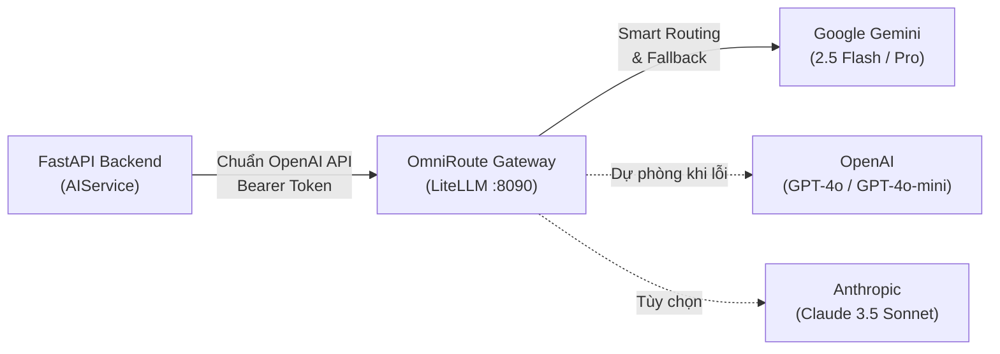

# 🤖 Tính Năng AI Hub & Trợ Lý SEO (AI Hub & SEO Assistant)

Module AI Hub là trung tâm trí tuệ nhân tạo của hệ thống, kết nối backend với các mô hình ngôn ngữ lớn (LLM) thông qua **OmniRoute AI Gateway**, hỗ trợ biên tập viên tối ưu hóa nội dung, tự động sinh thẻ SEO, tóm tắt bài viết, và kiểm soát chi phí token theo thời gian thực.

---

## 1. 🌐 Kiến Trúc AI Gateway (OmniRoute Integration)

Thay vì kết nối trực tiếp đến từng nhà cung cấp (Google Gemini, OpenAI, Anthropic) với các thư viện SDK phân mảnh, hệ thống chuẩn hóa luồng giao tiếp thông qua **OmniRoute (triển khai trên nền LiteLLM)**:

### Ưu điểm:
- **Tính độc lập cao:** Có thể đổi API Key, chuyển đổi model AI hoặc cấu hình tỉ lệ cân bằng tải trực tiếp trên OmniRoute mà không cần restart máy chủ backend hay sửa code.
- **Khả năng dự phòng (Fallback):** Nếu một nhà cung cấp gặp sự cố hoặc vượt giới hạn rate limit, OmniRoute tự động chuyển tiếp request sang nhà cung cấp dự phòng mà không làm gián đoạn trải nghiệm người dùng.

---

## 2. 🪄 Các Trợ Lý AI Hỗ Trợ Biên Tập Viên (AI Features)

### 1. Tự Động Sinh Thẻ Meta SEO (SEO Metadata Generation)
- **Endpoint:** `POST /api/v1/ai-hub/generate-seo`
- **Cách hoạt động:** AI tiếp nhận tiêu đề và nội dung bài viết, áp dụng prompt kỹ thuật để sinh cấu trúc JSON chứa:
  - `meta_title`: Tiêu đề hấp dẫn, chuẩn 50 - 60 ký tự, chứa từ khóa chính.
  - `meta_description`: Đoạn mô tả lôi cuốn từ 150 - 160 ký tự, thúc đẩy tỉ lệ nhấp (CTR).
  - `meta_keywords`: 5 - 10 từ khóa cốt lõi của bài viết.

### 2. Tự Động Tóm Tắt Bài Báo (AI Article Summarizer)
- Rút trích bài báo khoa học hoặc tin tức dài hàng nghìn từ thành đoạn tóm tắt 2 - 3 câu súc tích phục vụ hiển thị trên thẻ bài viết trang chủ và thông báo mạng xã hội.

### 3. Phân Tích & Chấm Điểm Chất Lượng SEO (SEO Score & Analysis)
- Đánh giá mật độ từ khóa, độ rõ ràng của cấu trúc thẻ heading (H1, H2, H3) và độ dài bài viết, đưa ra khuyến nghị chỉnh sửa trước khi xuất bản.

---

## 3. 📊 Giám Sát Chi Phí & Nhật Ký Token (AI Request Logs & Quota)

Mỗi lần gọi AI đều được ghi lại vào bảng `ai_request_logs`:
- **`model_name` & `provider`:** Mô hình và nhà cung cấp phục vụ yêu cầu.
- **`prompt_tokens` & `completion_tokens`:** Số lượng token đầu vào và đầu ra.
- **`estimated_cost`:** Chi phí ước tính bằng USD được tự động tính toán dựa trên bảng đơn giá của mô hình.
- **`latency_ms`:** Thời gian phản hồi của mô hình (mili-giây).
- **`user_id`:** Quản trị viên đã yêu cầu tác vụ AI.

Quản trị viên có thể xem biểu đồ tổng lượng token đã dùng trong tháng qua Dashboard để quản lý ngân sách vận hành hiệu quả.
