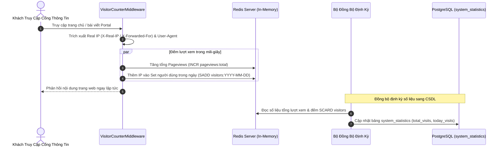

# 📊 Tính Năng Thống Kê & Giám Sát Hệ Thống (Analytics & Monitoring)

Để đảm bảo hệ thống vận hành liên tục, ổn định và cung cấp dữ liệu số liệu truyền thông chính xác cho ban giám hiệu, KTCN Backend tích hợp sẵn bộ công cụ **Đếm Lượt Truy Cập Thời Gian Thực (Visitor Counter)**, **API Thống Kê Dashboard** và **Cơ Chế Kiểm Tra Sức Khỏe (Health Check)**.

---

## 1. 👥 Bộ Đếm Lượt Truy Cập Thời Gian Thực (Visitor Counter Middleware)

Thay vì ghi trực tiếp vào cơ sở dữ liệu quan hệ cho mỗi lượt xem trang (dễ gây tắc nghẽn CSDL khi lưu lượng truy cập tăng đột biến), hệ thống sử dụng **Redis Caching** để đếm lượt truy cập hiệu năng cao:



### Các chỉ số được theo dõi:
- **Tổng lượt truy cập (Total Visits):** Tổng số lượt tải trang tích lũy từ ngày hệ thống vận hành.
- **Lượt truy cập hôm nay (Today Visits):** Số lượng người dùng duy nhất (Unique Visitors) truy cập trong ngày hiện tại.
- **Số liệu hiển thị Footer Portal:** Cung cấp qua API `GET /api/v1/statistics` hiển thị widget chân trang website Trường.

---

## 2. 📈 Admin Dashboard Analytics

Cung cấp cho Ban Giám hiệu và Quản trị viên bức tranh toàn cảnh về hoạt động của Trường:
- **Endpoint:** `GET /api/v1/admin/dashboard`
- **Số liệu tổng quan:**
  - Tổng số bài viết đang xuất bản / bản nháp.
  - Tổng số cán bộ giảng viên và đơn vị trực thuộc.
  - Số lượng hồ sơ tuyển sinh mới đang chờ xử lý (`pending leads`).
  - Biểu đồ tăng trưởng lưu lượng truy cập theo tuần và theo tháng.
  - Thống kê tỷ lệ bài viết theo danh mục.

---

## 3. 💓 Cơ Chế Kiểm Tra Sức Khỏe Hệ Thống (Health Check API)

Hệ thống cung cấp endpoint kiểm tra tình trạng dịch vụ tại địa chỉ gốc:
- **Endpoint:** `GET /health`
- **Quy trình kiểm tra:**
  1. Gửi truy vấn kiểm tra kết nối tới cơ sở dữ liệu PostgreSQL (`SELECT 1`).
  2. Gửi lệnh `PING` tới dịch vụ bộ nhớ đệm Redis.
- **Kết quả phản hồi:**
  - `200 OK`: Toàn bộ các dịch vụ nền tảng đều hoạt động bình thường.
    ```json
    {
      "status": "healthy",
      "database": "connected",
      "redis": "connected",
      "timestamp": "2026-10-11T09:30:00Z"
    }
    ```
  - `503 Service Unavailable`: Một trong các dịch vụ cốt lõi bị mất kết nối, giúp các hệ thống giám sát hạ tầng (như Docker Compose Healthcheck, Kubernetes Liveness Probe, Uptime Kuma) lập tức gửi cảnh báo sự cố hoặc tự động khởi động lại container.
