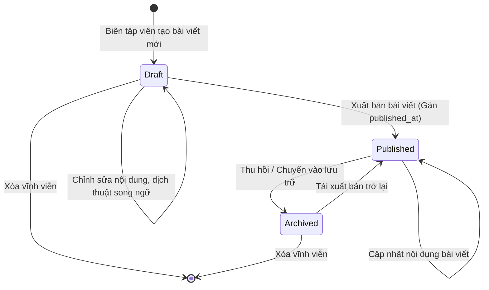
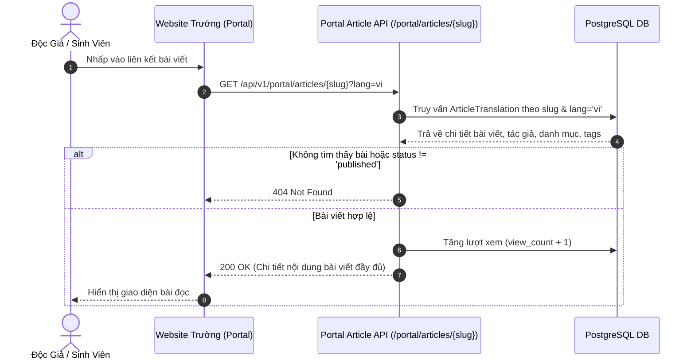

# 📰 Tính Năng Quản Lý Bài Viết & Nội Dung (Article & Content Management)

Module Bài viết và Nội dung là trái tim của hệ thống CMS Trường Kỹ Thuật và Công Nghệ, cung cấp công cụ biên tập phong phú, quản lý danh mục đa tầng, gắn thẻ phân loại, và tối ưu hóa công cụ tìm kiếm (SEO).

---

## 1. 🔄 Vòng Đời Bài Viết (Article Lifecycle State Machine)

Một bài viết trên hệ thống trải qua 3 trạng thái chính:

- **`draft` (Bản nháp):** Bài viết đang trong quá trình soạn thảo, hoàn thiện bản dịch song ngữ hoặc chờ phê duyệt. Chỉ có tác giả hoặc quản trị viên có quyền xem qua API `/api/v1/admin/articles`.
- **`published` (Đã xuất bản):** Bài viết hiển thị công khai trên Cổng thông tin tại `/api/v1/portal/articles`. Hệ thống ghi nhận mốc thời gian xuất bản `published_at`.
- **`archived` (Lưu trữ):** Bài viết hết thời hạn hoặc tạm ẩn khỏi danh sách tin mới trên trang chủ, nhưng vẫn được bảo toàn trong cơ sở dữ liệu.

---

## 2. 🗂️ Quản Lý Cây Danh Mục (Hierarchical Categories)

Hệ thống danh mục bài viết hỗ trợ cấu trúc phân nhánh cha - con không giới hạn cấp độ:
- **`parent_id`:** Định danh danh mục cấp trên (nếu là danh mục gốc thì `parent_id = None`).
- **`is_locked`:** Cờ bảo vệ các danh mục cốt lõi của Trường (như *Tin tức chung*, *Thông báo đào tạo*, *Tuyển sinh*) tránh việc người dùng vô tình bấm xóa.
- **`is_weekly_schedule`:** Đánh dấu danh mục đặc thù cho việc hiển thị *Lịch tuần công tác* của Ban Giám hiệu và các Bộ môn.
- **`sort_order`:** Trọng số điều khiển thứ tự hiển thị ưu tiên trên thanh điều hướng website.

---

## 3. 🏷️ Hệ Thống Thẻ Đa Ngôn Ngữ (Multilingual Tags)

- Bài viết có thể gắn nhiều thẻ (Tags) thông qua quan hệ Nhiều - Nhiều (N-N) trong bảng liên kết `article_tags`.
- Thẻ cũng sở hữu tên và slug dịch theo từng ngôn ngữ (ví dụ: thẻ `'Hội thảo khoa học'` tương ứng với slug `'hoi-thao-khoa-hoc'` ở Tiếng Việt và `'scientific-seminar'` ở Tiếng Anh).

---

## 4. 📈 Đọc Bài Viết & Tăng Lượt Xem Bất Đồng Bộ (View Counter Workflow)

Khi người dùng mở một bài viết trên Cổng thông tin:
1. Hệ thống tìm kiếm bài viết theo `slug` và mã ngôn ngữ `lang`.
2. Kiểm tra điều kiện xuất bản (`status = 'published'`).
3. Thực hiện tăng bộ đếm lượt xem (`view_count = view_count + 1`) một cách bất đồng bộ trong nền, không làm chặn luồng trả về dữ liệu nội dung bài viết.

---

## 5. 🎯 Tối Ưu Hóa Tìm Kiếm (SEO Metadata Helper)

Mỗi bài viết sở hữu các trường SEO riêng biệt cho từng ngôn ngữ:
- `meta_title`: Tiêu đề hiển thị trên thanh tab trình duyệt và kết quả tìm kiếm Google (tối ưu 50 - 60 ký tự).
- `meta_description`: Đoạn tóm tắt hiển thị dưới kết quả tìm kiếm Google (tối ưu 150 - 160 ký tự).
- `meta_keywords`: Danh sách từ khóa phân tách bằng dấu phẩy.
- `canonical_url`: Đường dẫn gốc ngăn ngừa trùng lặp nội dung khi bài viết được liên kết từ nhiều nguồn.
