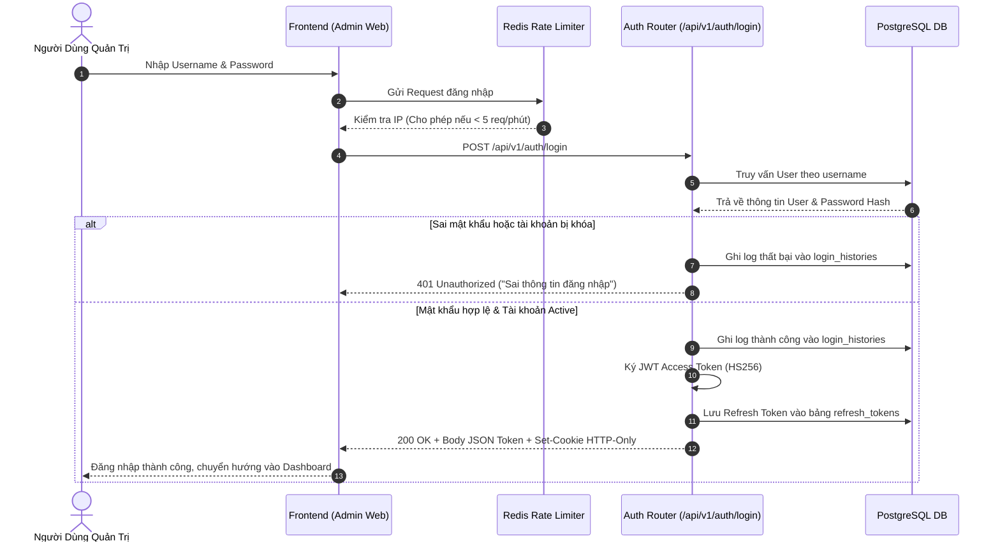
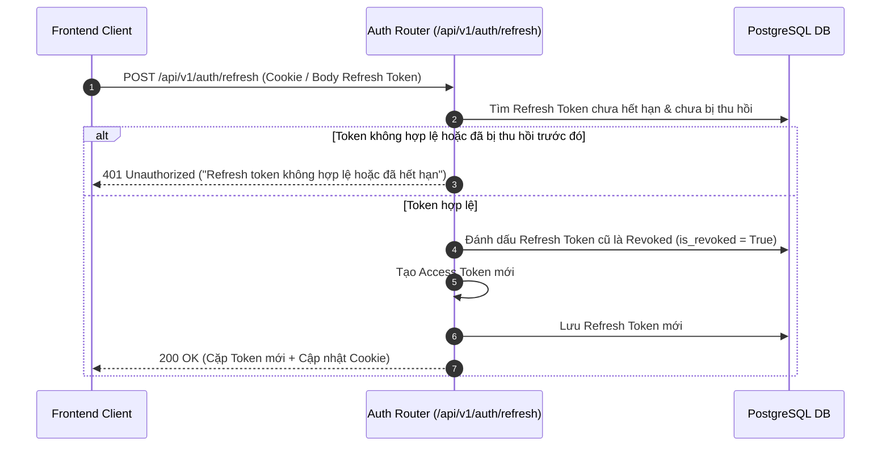

# 🔐 Tính Năng Xác Thực & Bảo Mật (Authentication & Security)

Hệ thống xác thực và kiểm soát truy cập của KTCN Backend API được xây dựng theo chuẩn mực công nghiệp hiện đại, kết hợp giữa mô hình **JSON Web Token (JWT)**, cơ chế xoay vòng phiên **(Refresh Token Rotation)**, bảo vệ chống XSS qua **HTTP-Only Cookies**, và phân quyền chi tiết dựa trên vai trò **(RBAC - Role-Based Access Control)**.

---

## 1. 🔄 Luồng Đăng Nhập & Cấp Phát Token (Login & Token Issuance Flow)

Khi người dùng gửi thông tin đăng nhập (`username`, `password`):
1. Hệ thống áp dụng **Rate Limiting** (tối đa 5 lượt gọi/phút từ cùng một IP) để ngăn chặn tấn công brute-force.
2. Kiểm tra tài khoản trong bảng `users`: Xác thực mật khẩu thông qua thư viện `bcrypt`.
3. Kiểm tra trạng thái tài khoản: Nếu `is_active = False` sẽ từ chối truy cập.
4. Ghi nhận nhật ký vào bảng `login_histories` (lưu IP, User-Agent, thời gian và trạng thái).
5. Sinh cặp Token:
   - **Access Token:** Ký bằng thuật toán `HS256` với `SECRET_KEY`, chứa `user_id`, `role`, `permissions`.
   - **Refresh Token:** Sinh ngẫu nhiên mã an toàn, lưu mã băm vào bảng `refresh_tokens` với thời hạn hết hạn (`expires_at`).
6. Trả kết quả: Hệ thống hỗ trợ song song cả **JSON Body** (cho di động hoặc client dùng Bearer header) và **Set-Cookie (HTTP-Only, SameSite=Lax)** để bảo vệ client Web trước lỗ hổng đánh cắp token bằng mã độc XSS.

### Sơ đồ tuần tự đăng nhập:

---

## 2. 🔁 Luồng Xoay Vòng Refresh Token (Token Rotation Workflow)

Để ngăn chặn việc kẻ xấu tái sử dụng Refresh Token bị rò rỉ (Replay Attack), hệ thống áp dụng cơ chế **Refresh Token Rotation**: Mỗi khi sử dụng Refresh Token để lấy Access Token mới, Refresh Token cũ sẽ bị **thu hồi ngay lập tức (`is_revoked = True`)** và một Refresh Token hoàn toàn mới sẽ được phát hành thay thế.

---

## 3. 👥 Phân Quyền Chi Tiết (Role-Based Access Control - RBAC)

Hệ thống bảo vệ các API quản trị bằng cơ chế Dependency Injection của FastAPI:

- **`get_current_active_user`:** Giải mã Access Token từ Header `Authorization: Bearer <token>` hoặc từ Cookie `access_token`. Kiểm tra tính hợp lệ của chữ ký JWT và đảm bảo tài khoản đang hoạt động.
- **`require_permissions(*required_permissions)`:** Kiểm tra xem người dùng hiện tại có chứa đầy đủ các quyền hạn (permissions) cần thiết để thực hiện thao tác hay không.

### Bảng các quyền hạn chính trong hệ thống:
| Mã quyền (Permission) | Ý nghĩa nghiệp vụ |
|---|---|
| `MANAGE_USERS` | Tạo, cập nhật trạng thái, phân quyền tài khoản người dùng. |
| `MANAGE_ARTICLES` | Tạo, sửa, xóa, duyệt và xuất bản bài viết, tin tức. |
| `MANAGE_CATEGORIES` | Thêm, sửa, sắp xếp cây danh mục bài viết. |
| `MANAGE_STAFF` | Quản lý danh sách cán bộ, giảng viên, hồ sơ khoa học. |
| `MANAGE_DEPARTMENTS` | Quản trị cơ cấu khoa, viện, bộ môn trực thuộc. |
| `MANAGE_PROGRAMS` | Quản lý thông tin và chương trình đào tạo. |
| `MANAGE_LEADS` | Tiếp nhận và xử lý hồ sơ tư vấn tuyển sinh. |
| `MANAGE_MEDIA` | Tải lên và quản lý tập tin trong bucket lưu trữ. |
| `MANAGE_SYSTEM` | Cấu hình tham số hệ thống, AI Gateway và dịch thuật. |

---

## 4. 📝 Ghi Vết Kiểm Toán (Audit Trail / Audit Logs)

Mọi hành động thay đổi dữ liệu trên các cổng quản trị (`/api/v1/admin/*`) đều được tự động lưu vào bảng `audit_logs`:
- **`actor_id`:** UUID của người dùng quản trị thực hiện hành động.
- **`action`:** Loại hành động (`CREATE`, `UPDATE`, `DELETE`, `PUBLISH`, `ARCHIVE`).
- **`entity_name`:** Tên thực thể bị tác động (`Article`, `Department`, `User`, ...).
- **`entity_id`:** Định danh bản ghi bị tác động.
- **`changes`:** Bản ghi JSON chi tiết các trường trước và sau khi thay đổi (Diff JSON), giúp dễ dàng truy vết và phục hồi khi có sự cố.
