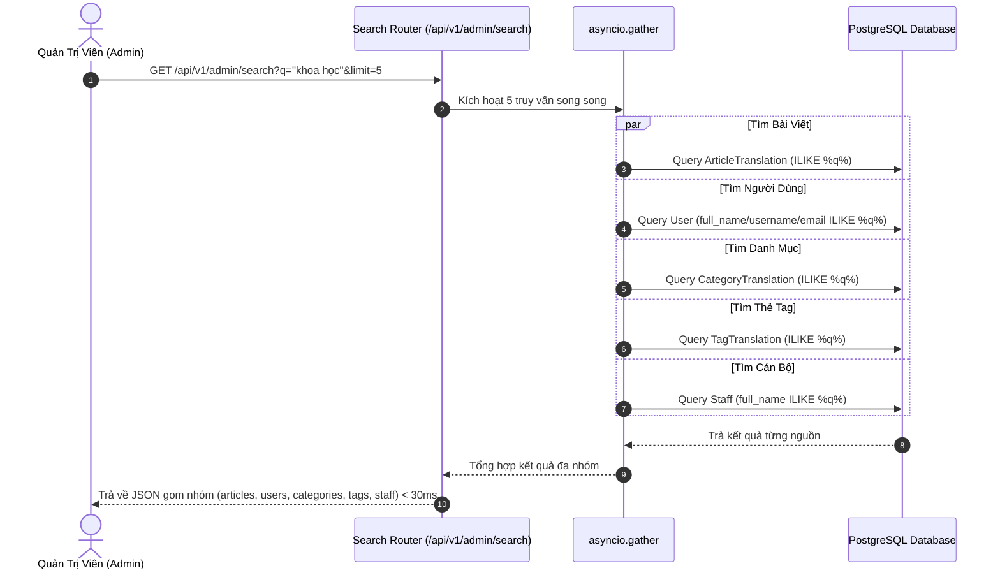

# 🔍 Tìm Kiếm Toàn Cục & Thư Viện Hình Ảnh (Global Search & Gallery)

Tài liệu này mô tả chi tiết cơ chế Tìm kiếm đa nguồn thời gian thực (**Global Multi-Source Search**) và phân hệ Quản trị Thư viện Ảnh (**Campus & Department Gallery**) trong hệ thống **KTCN Backend API**.

---

## 1. 🔍 Tìm Kiếm Toàn Cục Đa Nguồn (Global Multi-Source Search)

### Vấn đề nghiệp vụ:
Người quản trị trên Admin Portal cần một thanh tìm kiếm nhanh toàn diện (Command Palette / Quick Search Bar `Cmd + K`) để tra cứu tức thì thông tin qua nhiều thực thể dữ liệu khác nhau mà không phải chuyển đổi thủ công qua từng trang danh sách.

### Luồng xử lý kỹ thuật (`app/modules/search/router.py`):
- Endpoint: `GET /api/v1/admin/search?q={keyword}&limit=5`
- Tham số:
  - `q`: Từ khóa tìm kiếm (bắt buộc, tối thiểu 1 ký tự).
  - `limit`: Giới hạn số lượng kết quả cho mỗi nhóm thực thể (mặc định: 5, tối đa: 20).
- Hệ thống kích hoạt thực thi **song song bất đồng bộ** bằng `asyncio.gather` qua 5 nguồn dữ liệu:
  1. `_search_articles`: Tìm theo tiêu đề bài viết trong bảng `article_translations` (áp dụng `DISTINCT ON (article_id)` kết hợp `Article.deleted_at.is_(None)`).
  2. `_search_users`: Tìm theo họ tên (`full_name`), tên tài khoản (`username`) hoặc email (`email`) trong bảng `users`.
  3. `_search_categories`: Tìm theo tên danh mục trong `category_translations`.
  4. `_search_tags`: Tìm theo tên nhãn thẻ trong `tag_translations`.
  5. `_search_staff`: Tìm theo họ tên giảng viên trong `staff`.

### Sơ đồ luồng tìm kiếm song song:


---

## 2. 🖼️ Quản Lý Thư Viện Hình Ảnh (Gallery & Media Albums)

### Vấn đề nghiệp vụ:
Các hoạt động sinh hoạt học thuật, sự kiện kỷ niệm, lễ tốt nghiệp và cơ sở vật chất của các Khoa/Bộ môn được tổ chức dưới dạng các album ảnh chuyên nghiệp (`Gallery`) để trình chiếu trên Cổng thông tin công khai và trang giới thiệu của Bộ môn.

### Cấu trúc mô hình dữ liệu (`app/modules/gallery/models.py`):
1. **`Gallery` (Album ảnh):**
   - `id`: Định danh UUID khóa chính.
   - `department_id`: Liên kết ngoại với đơn vị/bộ môn (`Department`) hoặc để trống nếu là thư viện chung toàn trường.
   - `cover_object_key`: Khóa đối tượng ảnh đại diện lưu trong MinIO S3.
   - `sort_order`, `is_active`: Thứ tự sắp xếp và trạng thái kích hoạt.
   - `translations`: Bảng dịch đa ngôn ngữ lưu `title`, `description` theo mã ngôn ngữ (`vi`, `en`).
2. **`GalleryItem` (Ảnh trong album):**
   - `id`, `gallery_id`: Liên kết thuộc về album.
   - `media_item_id`: Khóa ngoại tùy chọn liên kết với bảng `media_items`.
   - `object_key`, `thumbnail_key`: Đường dẫn file ảnh gốc và ảnh thu nhỏ (thumbnail) trên MinIO S3.
   - `caption`, `alt_text`: Chú thích ảnh và văn bản mô tả hỗ trợ SEO / trợ năng.
   - `sort_order`, `is_active`: Vị trí ảnh trong trình xem lướt ảnh (Lightbox/Carousel).

### Luồng phân giải URL ảnh tự động (Media URL Resolution):
Khi trả dữ liệu về cho Client, backend tự động chuyển đổi `object_key` nội bộ thành URL truy cập trực tiếp qua hàm `media_url()`:
```python
def media_url(key: str) -> str:
    if not key or key.startswith(("http://", "https://")):
        return key
    protocol = "https" if settings.MINIO_SECURE else "http"
    return f"{protocol}://{settings.MINIO_ENDPOINT}/{settings.MINIO_BUCKET}/{key}"
```

---

## 3. 📋 Bảng API Endpoints

| Method | Endpoint | Quyền hạn | Mô tả |
| :--- | :--- | :---: | :--- |
| `GET` | `/api/v1/admin/search` | Authenticated | Tìm kiếm nhanh toàn cục đa nguồn (bài viết, user, danh mục, tag, cán bộ) |
| `GET` | `/api/v1/admin/gallery` | Authenticated | Danh sách album ảnh trong Admin (phân trang, lọc theo department) |
| `POST` | `/api/v1/admin/gallery` | Authenticated | Tạo mới album ảnh kèm danh sách items |
| `GET` | `/api/v1/admin/gallery/{id}` | Authenticated | Chi tiết album ảnh |
| `PUT` | `/api/v1/admin/gallery/{id}` | Authenticated | Cập nhật thông tin album và sắp xếp ảnh |
| `DELETE`| `/api/v1/admin/gallery/{id}` | Authenticated | Xóa album ảnh |
| `GET` | `/api/v1/portal/gallery` | Public | Danh sách album ảnh hiển thị trên Portal |
| `GET` | `/api/v1/portal/gallery/{id}` | Public | Xem chi tiết album và các ảnh thành viên trên Portal |
