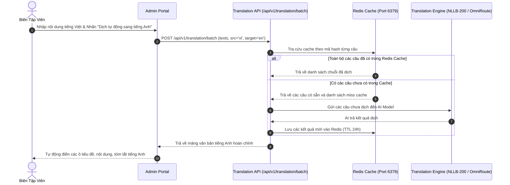

# 🌐 Tính Năng Đa Ngôn Ngữ & Dịch Thuật Tự Động (i18n & Translation)

Hệ thống được thiết kế để phục vụ truyền thông đại học đa quốc gia, hỗ trợ hiển thị nội dung theo nhiều ngôn ngữ khác nhau (mặc định là Tiếng Việt `vi` và Tiếng Anh `en`), đồng thời tích hợp công cụ **AI Tự Động Dịch Thuật (Auto-Translation Engine)** giúp biên tập viên tạo bản dịch song ngữ chỉ với 1 cú click.

---

## 1. 🏗️ Mô Hình Đa Ngôn Ngữ & Dự Phòng (Language Fallback Strategy)

Khi một yêu cầu từ người dùng gửi đến Cổng thông tin (Portal) kèm tham số ngôn ngữ (ví dụ `?lang=en`):
1. Hệ thống tìm kiếm bản dịch tương ứng trong bảng `*_translations` với điều kiện `language_code = 'en'`.
2. **Cơ chế Fallback thông minh:** Nếu bản ghi chưa có bản dịch tiếng Anh, hệ thống sẽ tự động lấy bản dịch mặc định (Tiếng Việt `vi`) để đảm bảo giao diện người dùng không bị rỗng nội dung hoặc gãy bố cục giao diện.

---

## 2. 🤖 Động Cơ Dịch Thuật AI Kép (Hybrid AI Translation Engine)

KTCN Backend hỗ trợ 2 cơ chế dịch thuật linh hoạt:

1. **Mô hình Dịch Cục Bộ (Local AI Model - NLLB-200):**
   - Sử dụng model **Meta NLLB-200** (`facebook/nllb-200-distilled-1.3B`).
   - Được làm nóng (Warmup) ngay trong giai đoạn khởi động của FastAPI Lifespan.
   - Thích hợp khi máy chủ có GPU hoặc chạy môi trường On-Premise không có kết nối Internet ra bên ngoài.
2. **AI Cloud Gateway (OmniRoute / LiteLLM):**
   - Kết nối qua giao thức chuẩn tới các mô hình ngôn ngữ lớn (Gemini 2.5 Flash, GPT-4o).
   - Tối ưu cho việc dịch các tài liệu dài, bài báo khoa học, hoặc cấu trúc HTML phức tạp đòi hỏi ngữ cảnh tự nhiên.

---

## 3. ⚡ Bộ Nhớ Đệm Bản Dịch Bằng Redis (Translation Caching)

Để tối đa hóa tốc độ phản hồi và tiết kiệm tài nguyên tính toán/chi phí token AI:
- Mỗi văn bản cần dịch được băm (hash) thành khóa Redis theo công thức:
  `cache_key = "trans:" + md5(source_text + ":" + src_lang + ":" + target_lang)`
- **Thời gian sống (TTL):** 86,400 giây (24 giờ).
- Nếu văn bản đã từng được dịch trước đó, hệ thống sẽ trả kết quả ngay từ Redis trong vòng dưới **2 mili-giây** mà không cần gọi lại model AI.

### Sơ đồ luồng xử lý dịch tự động:

---

## 4. 🧩 Bảo Toàn Thẻ Định Dạng HTML (HTML-Aware Translation)

Bài viết và thông báo thường chứa các thẻ định dạng phức tạp như `<b>`, `<i>`, `<a href="...">`, ``, `<table>`.
- Trình dịch sử dụng `BeautifulSoup4` để bóc tách chỉ các đoạn văn bản (Text Nodes), giữ nguyên 100% cấu trúc cây DOM và thuộc tính thẻ HTML.
- Sau khi dịch xong nội dung văn bản, cây DOM được tái cấu trúc hoàn chỉnh, đảm bảo không làm vỡ giao diện bài viết trên website.

---

## 5. 📡 Các Endpoint API Dịch Thuật

| Phương thức | Endpoint | Mô tả chức năng |
|---|---|---|
| `POST` | `/api/v1/translation/text` | Dịch một đoạn văn bản đơn lẻ |
| `POST` | `/api/v1/translation/batch` | Dịch đồng thời mảng nhiều chuỗi ký tự (Batch Translation) |
| `POST` | `/api/v1/translation/html` | Dịch chuỗi HTML giữ nguyên định dạng thẻ |
| `GET` | `/api/v1/admin/languages` | Danh sách các ngôn ngữ được quản lý |
| `POST` | `/api/v1/admin/languages` | Thêm ngôn ngữ mới vào hệ thống |
| `GET` | `/api/v1/portal/languages` | Lấy danh sách ngôn ngữ đang kích hoạt (`is_active=True`) phục vụ bộ chuyển cờ trên Cổng thông tin |
