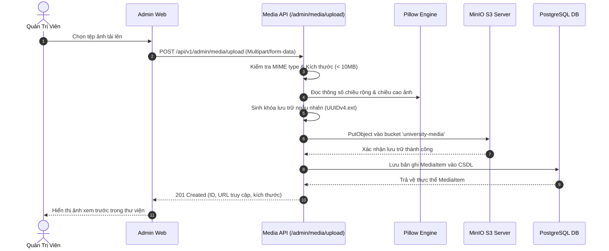

# 🖼️ Tính Năng Quản Lý Media & Lưu Trữ Tệp Tin (Media & Storage)

Hệ thống quản lý tài nguyên số (ảnh, tài liệu, biểu mẫu, video) của KTCN Backend API được tích hợp trực tiếp với dịch vụ **MinIO Object Storage** (chuẩn tương thích hoàn toàn với Amazon S3), đảm bảo an toàn dữ liệu, chống tấn công tệp độc hại và tối ưu tốc độ phân phối nội dung.

---

## 1. 🛡️ Quy Trình Tải Lên & Kiểm Duyệt An Toàn (Upload Workflow)

Mọi tệp tin khi được gửi lên qua API Quản trị (`POST /api/v1/admin/media/upload`) đều phải trải qua các bước kiểm duyệt nghiêm ngặt:

1. **Kiểm tra kích thước tệp:** Giới hạn tối đa cấu hình là 10MB (thông qua `RequestSizeLimiterMiddleware` và logic service).
2. **Kiểm tra định dạng MIME Type:**
   - Ảnh: `image/jpeg`, `image/png`, `image/webp`, `image/gif`.
   - Tài liệu giáo trình/văn bản: `application/pdf`, `.docx`, `.xlsx`.
3. **Băm tên tệp an toàn (UUIDv4):** Tên tệp lưu trữ trên MinIO được thay thế bằng mã băm duy nhất dạng `uuid4() + extension` để triệt tiêu hoàn toàn nguy cơ tấn công ghi đè tệp hoặc lỗ hổng điều hướng thư mục (Path Traversal).
4. **Trích xuất thông số ảnh:** Với tệp định dạng ảnh, hệ thống sử dụng thư viện `Pillow` để đọc kích thước thực tế (`width`, `height`), hỗ trợ frontend hiển thị khung hình không bị giật layout (Cumulative Layout Shift - CLS).
5. **Lưu trữ vào MinIO:** Đẩy luồng nhị phân (Binary Stream) vào bucket `university-media`.
6. **Lưu siêu dữ liệu (Metadata):** Ghi thông tin bản ghi vào bảng `media_items` trong cơ sở dữ liệu.

### Sơ đồ tuần tự Upload Media:


---

## 2. 🔗 Cơ Chế Phân Giải Đường Dẫn URL (HTML URL Resolver)

Trong nội dung các bài viết phong phú (Rich Text Content) được soạn thảo bằng TinyMCE hoặc Quill, ảnh có thể được nhúng dưới dạng đường dẫn tương đối `/api/v1/portal/media/file/{id}`.
- Khi người dùng đọc bài viết qua Portal API, hàm `resolve_html_urls` sẽ tự động quét và phân giải các đường dẫn này thành URL tuyệt đối trỏ trực tiếp đến máy chủ lưu trữ MinIO hoặc CDN:
  ```text
  /api/v1/portal/media/file/abc-123  ==>  http://minio-host:9000/university-media/abc-123.jpg
  ```
- Cơ chế này giúp giảm tải băng thông cho máy chủ Backend API và tận dụng được khả năng phục vụ tệp tĩnh tốc độ cao của MinIO / Nginx / CDN.

---

## 3. 📂 Thư Viện Media Dùng Chung (Media Picker)

- API Quản trị cung cấp endpoint phân trang `GET /api/v1/admin/media`: Hỗ trợ tìm kiếm theo tên tệp gốc, lọc theo loại MIME (`image`, `document`), và phân trang.
- Cho phép biên tập viên tái sử dụng các hình ảnh, biểu trưng logo đã tải lên trước đó cho nhiều bài viết, banner hoặc album đơn vị khác nhau mà không phải upload trùng lặp.
