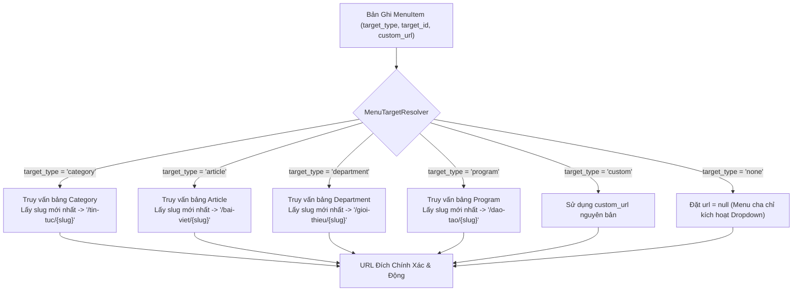
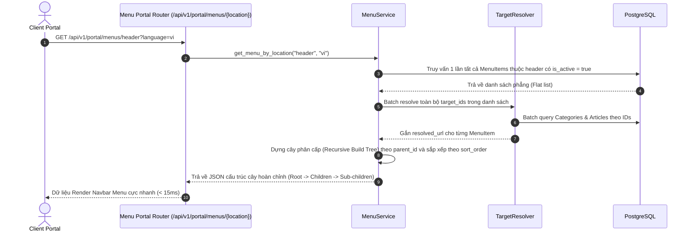

# 🧭 Phân Giải Menu Điều Hướng Động (Menu Target Resolution Flow)

Tài liệu này mô tả chi tiết thuật toán phân giải đích đến (Target Resolver), cơ chế quản lý liên kết động chống gãy link (Broken Link Prevention) và quy trình dựng cấu trúc cây Menu đa cấp trong **KTCN Backend API**.

---

## 1. Vấn Đề Thực Tế & Kiến Trúc Target Resolver

Trong các hệ thống CMS truyền thống, menu thường lưu trữ URL tĩnh (Hardcoded URL, ví dụ: `/tin-tuc/thong-bao-tuyen-sinh-2025`). Khi bài viết hoặc danh mục thay đổi tiêu đề hoặc đổi slug, toàn bộ liên kết trên menu sẽ bị gãy (lỗi 404).

Để giải quyết triệt để vấn đề này, **KTCN Backend API** thiết kế cơ chế **Target Resolver** tại `app/modules/menu/target_resolver.py`:

---

## 2. Các Loại Đích Đến Hỗ Trợ (Supported Target Types)

| Kiểu đích (`target_type`) | Tham số cần có | Cách phân giải URL tự động | Xử lý khi thực thể bị xóa |
|---|---|---|---|
| `category` | `target_id` (UUID danh mục) | Ghép nối prefix danh mục: `/chuyen-muc/{category.slug}` | Đánh dấu `is_broken = true`, url trở về rỗng |
| `article` | `target_id` (UUID bài viết) | Ghép nối prefix bài viết: `/bai-viet/{article.slug}` | Đánh dấu `is_broken = true`, thông báo cho Admin |
| `department` | `target_id` (UUID khoa/bộ môn) | Ghép nối prefix đơn vị: `/don-vi/{department.slug}` | Đánh dấu `is_broken = true` |
| `program` | `target_id` (UUID ngành học) | Ghép nối prefix chương trình: `/dao-tao/{program.slug}` | Đánh dấu `is_broken = true` |
| `custom` | `custom_url` (chuỗi URL) | Giữ nguyên URL người dùng nhập (hỗ trợ cả link ngoài) | Luôn hợp lệ |
| `none` | Không có | `url = null` | Thường dùng cho các nút menu cha cấp 1 |

---

## 3. Thuật Toán Dựng Cây Menu Đa Cấp (Hierarchical Tree Builder)

Để giảm thiểu số lượng truy vấn xuống CSDL, backend truy vấn toàn bộ danh sách phẳng các item của một Menu (`position = 'header'` hoặc `'footer'`) trong **duy nhất một truy vấn**, sau đó dựng cây phân cấp trong bộ nhớ RAM:

---

## 4. Xử Lý Các Mục Menu Bị Mồ Côi Khi Thực Thể Đích Bị Xóa

Hệ thống có bộ quét tự động phát hiện mục menu bị gãy link:
- Khi một bài viết hoặc danh mục bị xóa mềm (`is_deleted = True`), dịch vụ `MenuTargetResolver` tự động phát hiện liên kết đích không còn tồn tại.
- Thuộc tính `target_status` sẽ trả về `DELETED_OR_NOT_FOUND`.
- Phía Admin Portal sẽ hiển thị biểu tượng cảnh báo màu vàng tam giác kèm nhãn *"Thực thể liên kết đã bị xóa"* để quản trị viên kịp thời trỏ lại liên kết mới.

---

Tiếp tục tìm hiểu về quản lý cơ cấu tổ chức tại: **[Quản Lý Cơ Cấu Tổ Chức & Đào Tạo (organization-and-staff.md)](./organization-and-staff.md)**.
