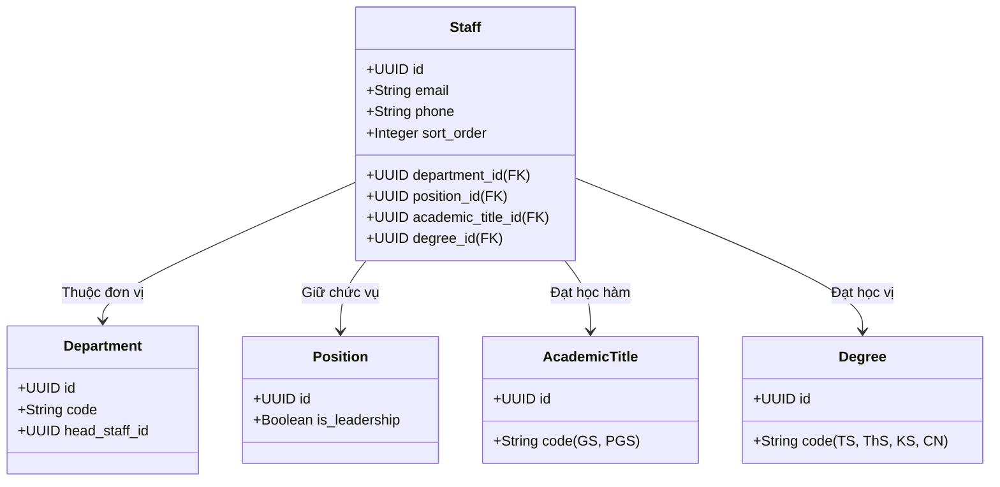

# 🏛️ Tính Năng Quản Lý Cơ Cấu Tổ Chức & Cán Bộ (Organization & Staff Management)

Module Tổ chức & Nhân sự quản lý toàn bộ cơ cấu khoa, viện, bộ môn trực thuộc Trường Kỹ Thuật và Công Nghệ - Đại Học Vinh, cùng với danh sách cán bộ, giảng viên, hồ sơ khoa học và thư viện hoạt động.

---

## 1. 🏢 Cơ Cấu Tổ Chức & Đơn Vị (Departments)

Mỗi đơn vị trực thuộc (Khoa/Viện/Bộ môn) được quản lý với đầy đủ thông tin nhận diện:
- **`code`:** Mã định danh đơn vị (ví dụ: `CNTT`, `DDT`, `CK`, `XD`).
- **Thông tin dịch đa ngữ (`DepartmentTranslation`):** Tên đơn vị, slug URL, phần giới thiệu tổng quan, chức năng nhiệm vụ, thông tin liên hệ (văn phòng, điện thoại, email).
- **Thư viện ảnh hoạt động (`DepartmentGallery`):** Quản lý các album ảnh về hoạt động giảng dạy, nghiên cứu, hội thảo và thực tập sinh viên của từng đơn vị.

---

## 2. 🎓 Học Hàm, Học Vị & Chức Vụ (Academic Titles, Degrees & Positions)

Để chuẩn hóa việc hiển thị danh xưng học thuật của đội ngũ giảng viên:

- **`AcademicTitle` (Học hàm):** Quản lý các cấp bậc nhà giáo như Giáo sư (GS), Phó Giáo sư (PGS).
- **`Degree` (Học vị):** Quản lý trình độ đào tạo như Tiến sĩ khoa học (TSKH), Tiến sĩ (TS), Thạc sĩ (ThS), Kỹ sư (KS), Cử nhân (CN).
- **`Position` (Chức vụ):** Quản lý vị trí công tác như Trưởng khoa, Phó Trưởng khoa, Trưởng bộ môn, Phó Trưởng bộ môn, Bí thư chi bộ, Chủ tịch công đoàn, Cố vấn học tập.

---

## 3. 👨‍🏫 Hồ Sơ Cán Bộ & Giảng Viên (Staff Profiles)

Bảng `staffs` và `staff_translations` lưu trữ chi tiết:
- **Thông tin cá nhân:** Họ và tên, ảnh chân dung đại diện (liên kết với MediaItem).
- **Thông tin liên lạc:** Email công vụ `@vinhuni.edu.vn`, số điện thoại bàn / di động, phòng làm việc.
- **Hồ sơ học thuật:** Hướng nghiên cứu chuyên sâu, các môn học đảm nhiệm, danh sách đề tài nghiên cứu khoa học, sách giáo trình đã xuất bản, và các bài báo khoa học trên các tạp chí quốc tế (ISI/Scopus).
- **Điều khiển sắp xếp (`sort_order`):** Đảm bảo cán bộ lãnh đạo (Ban chủ nhiệm khoa, Trưởng bộ môn) luôn hiển thị ở vị trí trang trọng đầu tiên trong danh sách cán bộ của từng đơn vị.

---

## 4. 🌐 Cung Cấp Dữ Liệu Cho Cổng Thông Tin (Public Portal API)

Hệ thống cung cấp các API công khai phục vụ giao diện giới thiệu nhân sự và cơ cấu tổ chức:
- `GET /api/v1/portal/departments`: Danh sách toàn bộ các khoa, bộ môn kèm thông tin lãnh đạo.
- `GET /api/v1/portal/departments/{slug}`: Chi tiết trang riêng của từng bộ môn, tích hợp danh sách giảng viên trực thuộc và thư viện ảnh.
- `GET /api/v1/portal/staffs`: Tra cứu toàn bộ giảng viên trong Trường (có bộ lọc theo đơn vị `department_id`, chức vụ, học hàm, học vị).
- `GET /api/v1/portal/staffs/{id}`: Chi tiết lý lịch khoa học của một giảng viên.
