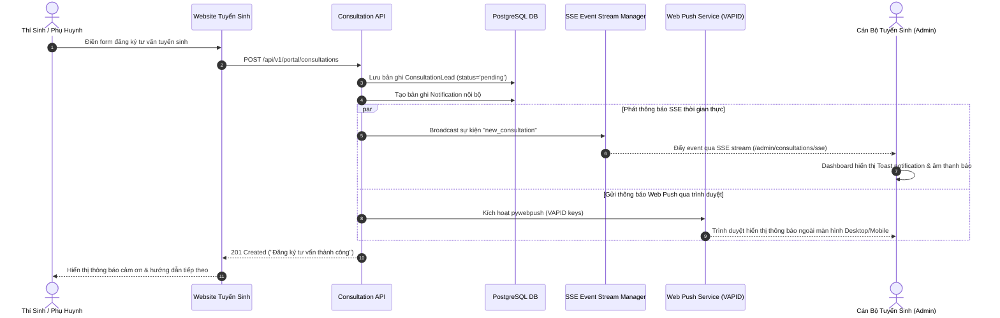

# 🎓 Tính Năng Đào Tạo & Tư Vấn Tuyển Sinh (Training & Consultation)

Module Đào tạo & Tư vấn tuyển sinh chịu trách nhiệm giới thiệu các ngành học trực thuộc Trường Kỹ Thuật và Công Nghệ, đồng thời cung cấp cổng tiếp nhận thông tin học sinh đăng ký xét tuyển với cơ chế phát thông báo thời gian thực **(Server-Sent Events - SSE)** và **Web Push Notifications**.

---

## 1. 📚 Quản Lý Chương Trình Đào Tạo (Academic Programs)

Hệ thống quản lý các chương trình đào tạo đa cấp độ:
- **Hệ đào tạo:** Đại học chính quy (Undergraduate), Sau đại học (Postgraduate: Thạc sĩ, Tiến sĩ).
- **Thông tin chi tiết (`ProgramTranslation`):** Tên ngành, mã ngành tuyển sinh, mục tiêu đào tạo, chuẩn đầu ra (PLO), thời gian đào tạo (năm), khối lượng tín chỉ, vị trí việc làm sau tốt nghiệp, và thông tin học bổng doanh nghiệp.
- **Khung chương trình học:** Danh mục khối kiến thức giáo dục đại cương, cơ sở ngành và chuyên ngành.

---

## 2. 📝 Quy Trình Tiếp Nhận Tư Vấn Tuyển Sinh (Consultation Leads Workflow)

Học sinh hoặc phụ huynh khi tìm hiểu ngành học trên Cổng thông tin có thể gửi thông tin liên hệ:
1. Gửi form tại Portal: Họ tên, số điện thoại, email, ngành quan tâm, lời nhắn.
2. Hệ thống kiểm tra hợp lệ dữ liệu (validate số điện thoại và định dạng email).
3. Lưu bản ghi mới vào bảng `consultation_leads` với trạng thái ban đầu là `pending`.
4. Kích hoạt thông báo đẩy ngay lập tức tới ban tư vấn tuyển sinh qua **SSE** và **Web Push**.

### Sơ đồ tuần tự xử lý Lead & Thông báo thời gian thực:

---

## 3. ⚡ Cơ Chế Thông Báo Server-Sent Events (SSE)

Khác với WebSocket yêu cầu duy trì kết nối hai chiều phức tạp, hệ thống sử dụng **Server-Sent Events (SSE)** - giao thức truyền tải một chiều nhẹ qua HTTP chuẩn:
- **Endpoint:** `GET /api/v1/admin/consultations/sse`
- Quản trị viên chỉ cần mở trang Admin Dashboard, trình duyệt sẽ tự động duy trì một kết nối HTTP mở `text/event-stream`.
- Mỗi khi có sự kiện tuyển sinh mới, máy chủ lập tức đẩy dữ liệu JSON về máy khách với độ trễ dưới **100 mili-giây**.

---

## 4. 📲 Thông Báo Trình Duyệt Web Push (W3C Push API & VAPID)

Hệ thống hỗ trợ thông báo đẩy trực tiếp tới màn hình máy tính hoặc điện thoại của cán bộ tuyển sinh ngay cả khi đang đóng tab quản trị:
1. **Đăng ký thiết bị:** Trình duyệt của Admin xin quyền thông báo (`Notification.requestPermission()`) và gửi Subscription Object (`endpoint`, `p256dh`, `auth`) lên backend lưu vào bảng `push_subscriptions`.
2. **Ký số & Gửi tin:** Khi có sự kiện cần thông báo, backend sử dụng thư viện `pywebpush` ký gói tin bằng cặp khóa **VAPID (Voluntary Application Server Identification)** và gửi tới máy chủ push của trình duyệt (Google FCM, Mozilla Push Service, Apple Push).
